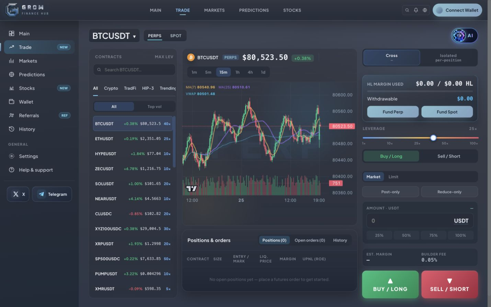
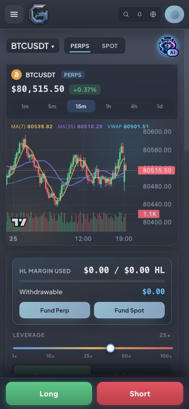
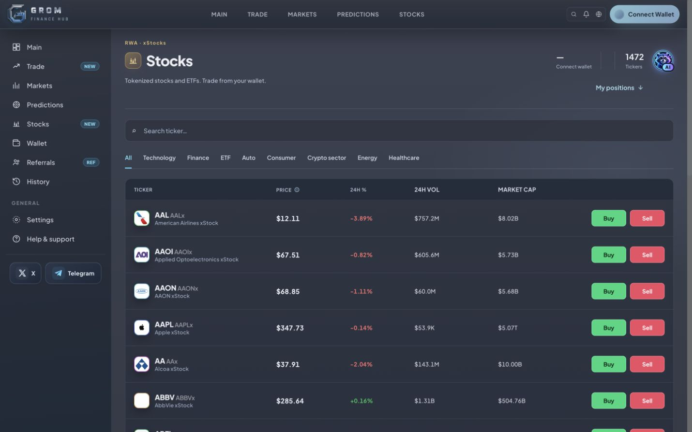
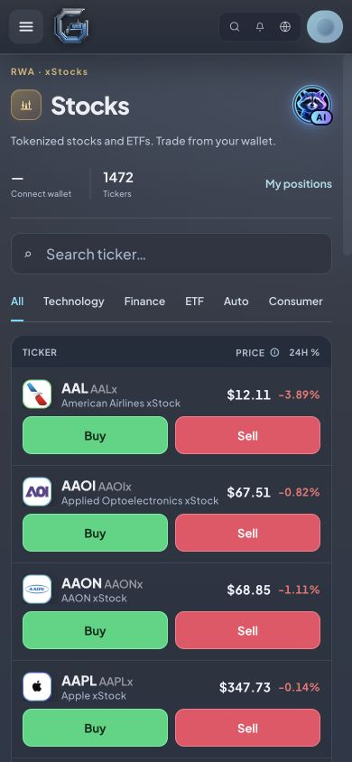

# Gromi spacing review — 25 October 2026

On narrow Trade screens the AI badge extended below its button into the chart card. The compact badge now stays within the button, with a 16 px gap above the next card. The pair selector can shrink and the chart quote can wrap on narrow screens. The provided Gromi artwork and animation are unchanged.

Stocks keeps My positions beside the mobile statistics and below the desktop statistics. The AI button is centered with the Stocks title; desktop statistics share that center. The main dashboard keeps its floating lower-right AI button, shifted 8 px right on desktop at the owner's request. The floating placement can sit over scrolling content; it was deliberately retained rather than moved into the header.

Only CSS changed. No API, balances, quote math, order handling or wallet signatures changed.

## Checks

- Build `2b0f23aaee`, frontend clean/syntax/product-health gate and 42-URL SEO regression passed. Git diff whitespace check passed.
- Chrome desktop 1440×900 and mobile 390×844: landing, main/Swap, Trade Perps and Spot, Markets, Predictions, event 32228, Stocks, Wallet and Help inspected. Navigation from landing completed; no Opening page message. Event ticket expands when changing to desktop, and its chart redraws after resize.
- Extra narrow/intermediate checks: Trade 320/401/600 px, Stocks 578 px, and earlier core-header checks at 320 px. Trade 320 px has no header collision or page overflow; the selected pair truncates in its selector while remaining fully named in the chart header.
- Stocks at 1440 px: title, AI and statistics all have center Y=126 px. At 578 px: title and AI center Y=116 px. My positions remains beside the statistics and scrolls to the positions section. No horizontal overflow at 390 px.
- AI chat opens at 320 px and closing restores focus. Product header buttons stay separate from the trading controls. Final event check logged no browser console errors.
- Referrals, History and Settings require wallet authentication in the current logged-out session. Their wallet-selection dialog was inspected at desktop/mobile sizes; authenticated contents were not verified. No wallet was connected and no financial operation was signed or submitted.
- These mobile checks use Chrome responsive viewport emulation, not a physical phone. Safari macOS animation/chat and MP4 playback were validated in the preceding Gromi change; physical iOS and low-power autoplay remain untested.

## Screenshots

