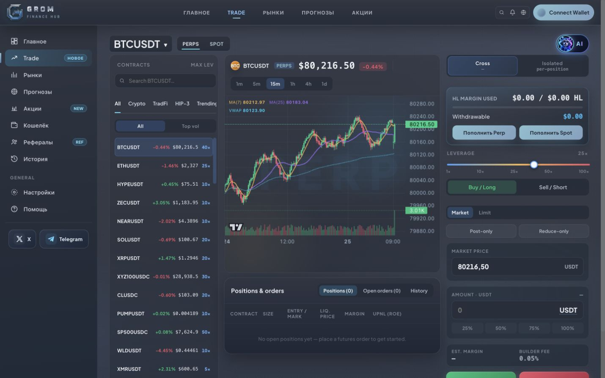
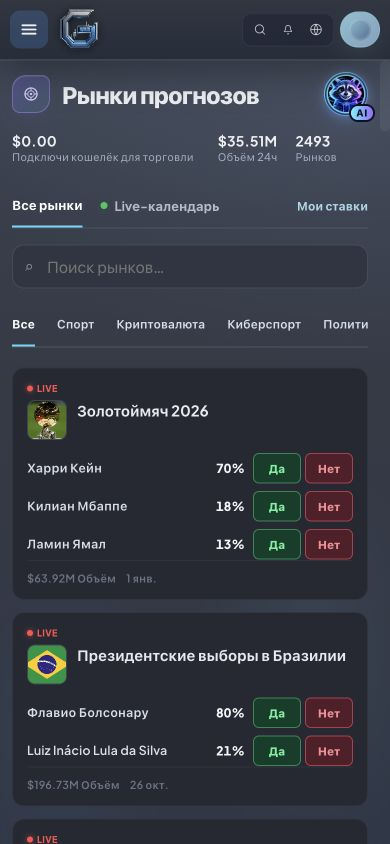
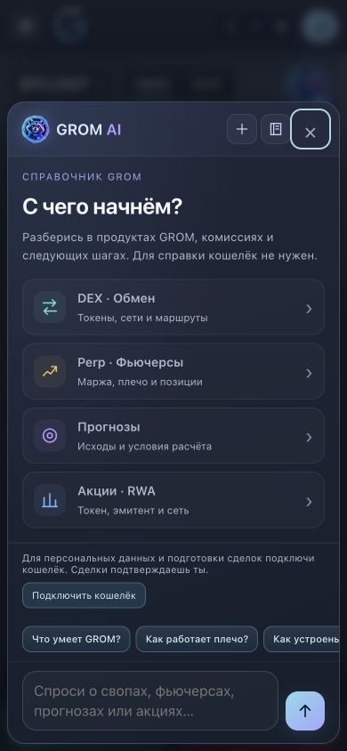
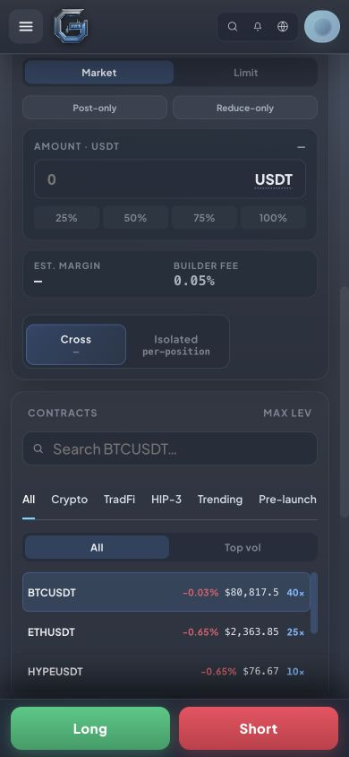

# Gromi assistant UI review

Branch: `codex/ai-gromi-launcher`. Prepared 25 October 2026. This report records validation before publication; deployment is authorized by the owner after successful checks.

The four media files and chat sprite come from the supplied `marketing/ai-assistant` package. The launcher styling follows its desktop/mobile previews. Launchers retain their existing accessible names and chat handlers. No API, quote calculation, wallet signing, swap or order execution changes.

The supplied animation lifecycle is adapted to also pause on route/background-tab changes, release detached videos, reattach after localized button content is replaced, and react to reduced-motion preference changes. Video sources load only for a visible launcher; hidden buttons retain their poster. The existing build hashes the separate launcher script; media filenames remain unchanged. Nginx now explicitly serves WebM and MP4 with video MIME types in its `/assets/` location; that location previously listed only image types.

Additional requested UI fixes: proportional sidebar social columns leave room for Telegram; mobile Cross/Isolated container is 232 px with both 112 px options preserved. Quote-only watchlist refreshes update text in existing rows instead of replacing the list DOM; structural changes still rebuild the list. This addresses refresh work, not upstream quote latency.

## Validation

- Frontend clean/syntax/product-health gate passed; build `368416ed89`; SEO regression passed for 42 URLs.
- Full local suite: 687 tests, 684 passed, 3 database-dependent skips, zero failures. Six new cases cover visible-only/background playback, dynamic launcher replacement/removal, reduced motion, unchanged quote DOM writes, and row reordering.
- Chrome 1440×900 and 390×844: `/futures`, `/markets`, `/predict`, event 32228, `/stocks#xstocks` (the canonical Stocks URL), `/swap` and chat. No horizontal overflow observed. Product header/event/mobile launchers are 44 px high; floating launcher is 52 px. Only the visible launcher's video plays; scrolling it off-screen pauses it. SPA navigation creates the new avatar correctly. Keyboard outline is 2 px; Enter opens chat; close restores focus. No console errors in final Trade/chat check.
- Desktop Telegram: client width and scroll width both 115 px. Mobile watchlist viewport remains 352 px / eight 44 px rows.
- Safari on macOS: Trade launcher and chat checked visually; supplied MP4 decoded and played to its full 12-second duration. Muted/inline attributes are set on every launcher video. A physical iPhone/iOS and low-power-mode autoplay were **not tested**. Reduced-motion behavior is covered by lifecycle tests, not a physical iOS setting test.
- Production nginx container was not run locally because Docker Desktop is not running; its existing image MIME map was reviewed and the two video mappings added. Playback was checked through the local preview server.
- No financial signatures, orders or transactions were performed.

## Screenshots

Desktop Trade, 1440×900:

Predictions, 390×844:

Chat, 390×844:

Compact Cross/Isolated card, 390×844:

