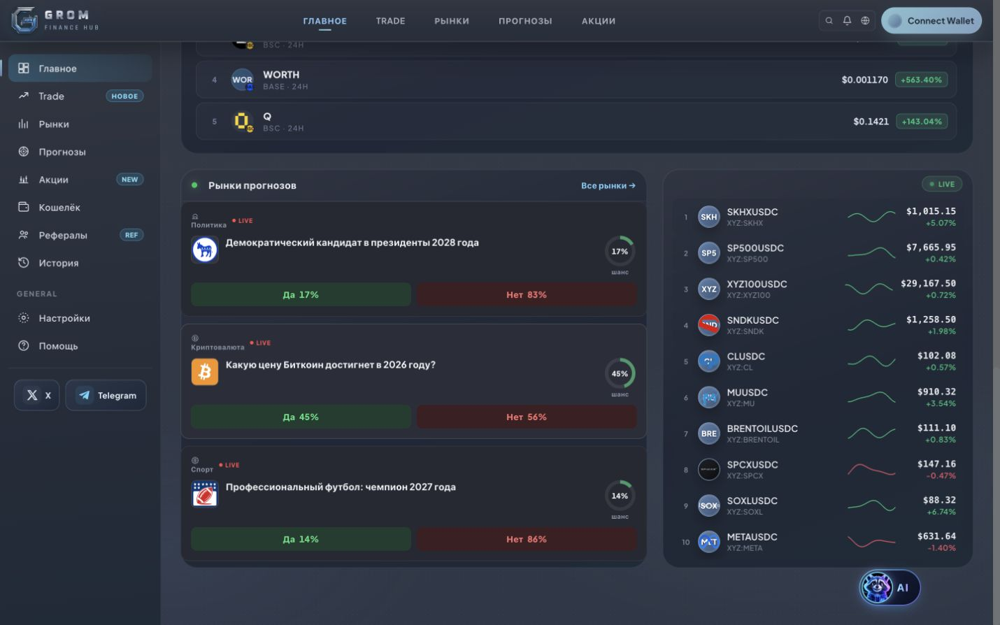
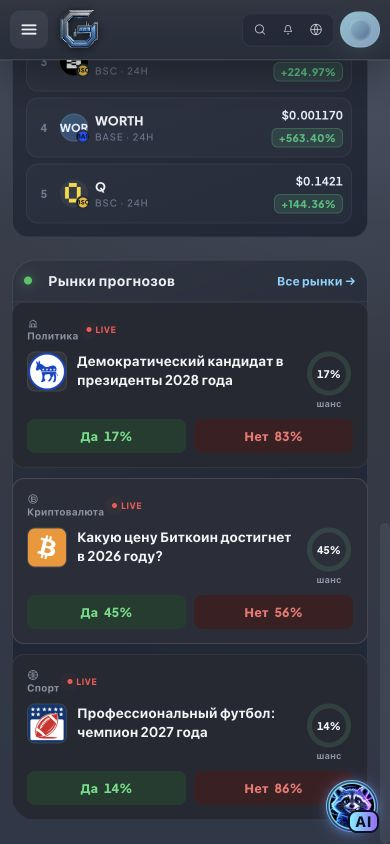

# Stock reference and homepage prediction consistency

Verified 27 October 2026 before publication. Frontend build `451fd7b9db`.

## Fixes

- A first stock reference or chart request initializes the canonical catalog instead of returning `unknown_xstock` merely because the catalog endpoint has not been visited. Concurrent requests share the same initialization. A failed or empty catalog remains unavailable and can retry; unknown symbols are still rejected after catalog validation.
- Homepage previews use a dedicated four-event, category-diverse server selection. The dashboard shows its first three events on every viewport. Prediction search, category filters, pagination and Safari's previous frozen preview no longer determine the homepage selection.

## Checks

- Backend: 694 tests, 691 passed, 3 database-dependent skipped, zero failures. Includes cold catalog initialization, concurrent requests, retry after upstream failure, official price/multiplier handling, unknown symbols, deterministic featured selection, viewport independence and locale races.
- ESLint: zero errors, six pre-existing warnings. Frontend build, source/syntax gate and 42 SEO route checks passed.
- Real read-only cold reference request to the local production router, without a prior catalog request: AALx returned HTTP 200, official xStocks price and Solana multiplier, about 7.97 seconds. Before the fix production returned `unknown_xstock` until `/xstocks` was fetched. External-provider latency and availability still apply; stale-reference protection remains enabled.
- Chrome desktop 1440×900 and mobile 390×844: exactly the same IDs and text (`pm_30829`, `pm_89502`, `pm_202857`). Visiting Predictions, selecting Sports and returning to Main preserved the set.
- Browser comparison uses a **captured real public catalog snapshot**, passed through the actual new server selection helper in the preview server, because direct Gamma TLS was unavailable from the local computer. Other public market data is live. This fixture is preview-only and is not shipped. Live featured endpoint will be checked after deployment.
- No wallet signatures or financial operations executed. Physical iPhone Safari and real settlement are not covered by this verification.

## Screenshots

