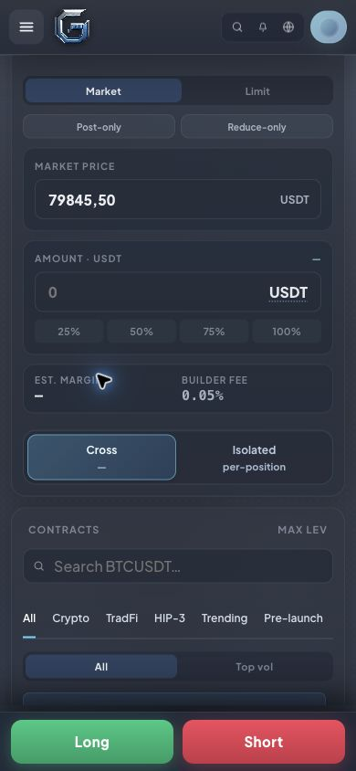

# Mobile margin selector width

The Cross / Isolated selector now fills the mobile order panel and aligns with the estimate/fee card above it. The change is scoped to the existing max-width: 760px Perps rule.

Verified in Chrome using the built frontend:

| Viewport width | Selector width | Estimate card width | Left edges |
| --- | --- | --- | --- |
| 320px | 260px | 260px | 25px / 25px |
| 390px | 330px | 330px | 25px / 25px |
| 682px | 622px | 622px | 25px / 25px |

No horizontal overflow at these mobile widths. At desktop 1440px the selector and estimate card remain 340px wide. Spot's balance selector remains 156px on desktop and mobile. No order or wallet action was submitted.

Frontend syntax/product-health gate and production build passed. APP_VER: `0a0b3eddb0`.

