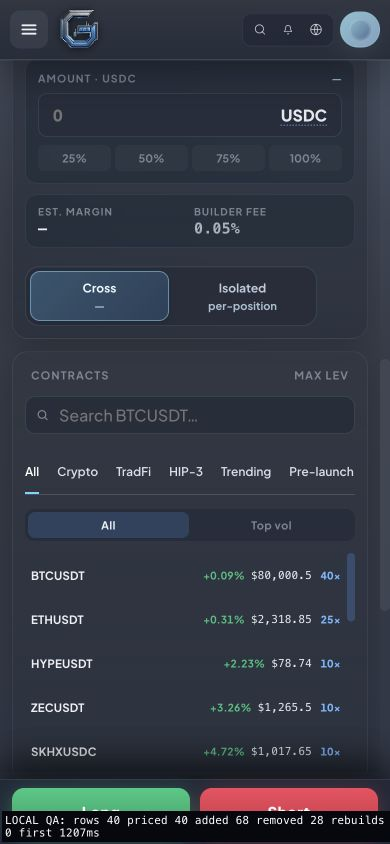
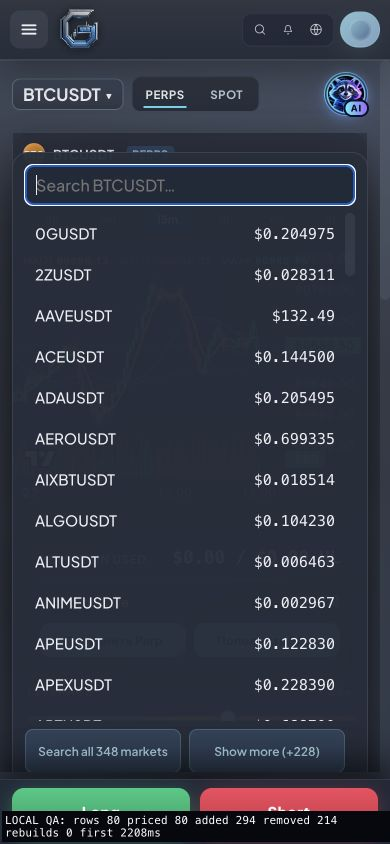
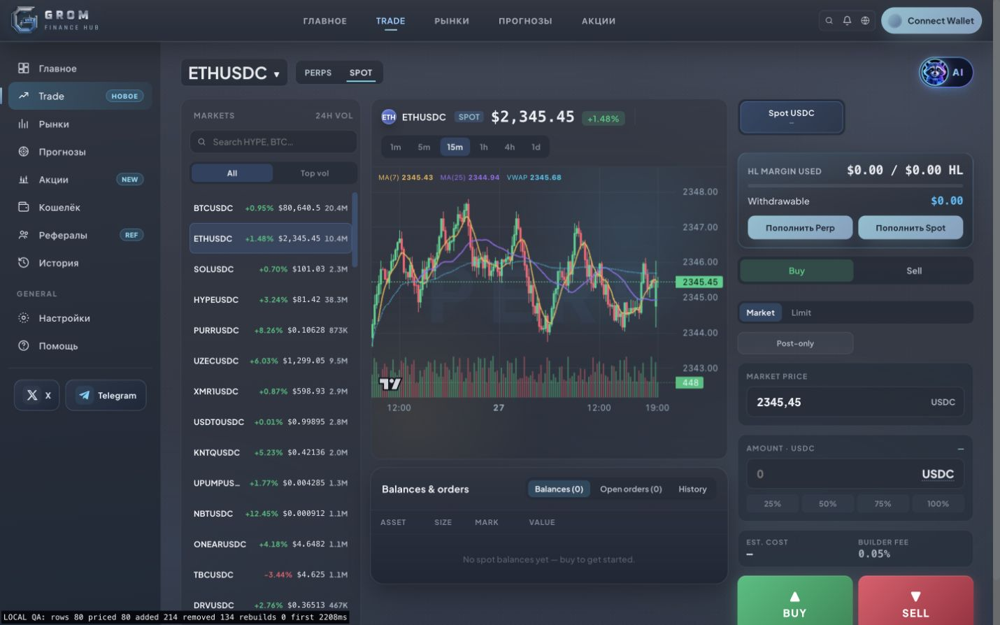

# Trade list, pair search and Trending verification — 2026-10-27

## Findings and changes

- Progressive venue discovery previously replaced the complete watchlist when count or order changed. The same local read-only proxy scenario recorded 3 full replacements before the fix and 0 afterwards. Existing pair rows/cells now survive discovery and reordering; quote text updates in place and the scroll anchor is retained.
- Pair search already included the full catalog, but its “Type to search” footer was inert and omitted pairs were inaccessible by browsing. It now has a focus shortcut and bounded Show more batches. Browser verification reached all 348 currently listed Perps markets (120 → 240 → 348), found SP500, and found/selected ETHUSDC in Spot. Escape closes the popup and resets expanded state.
- Mobile Cross/Isolated uses a compact 292px maximum card, equal columns, readable secondary text, visible selection and keyboard focus.
- Missing/invalid Trending prices render as unavailable rather than zero dollars. The provider h24 percentage remains unchanged; no extra multiplication is applied.

## Browser checks

Chrome desktop 1440×900, mobile 390×844, intermediate 682×664. Search footer stayed within the intermediate viewport (bottom 642px of 664px). Mobile popup and Cross/Isolated checked visually; desktop Spot selection updated the chart and selected row. No console errors in the final browser session. No orders, wallet signatures, or deposits submitted. Physical iPhone Safari was not tested in this pass.

Local diagnostic first populated quotes: 1207ms and 2208ms in separate runs; these are observations, not a network latency guarantee. Diagnostic overlay is preview-only and is not included in production files. The preview proxies public market/config data only.

## Trending source audit

Compared GROM rows to GeckoTerminal for identical chain + pool addresses on 27 October. ELON2028 (Ethereum pool 0x6c04cef807fe62c28d65159fc00b52e7a7d6f0266d2053fc95d6820f99beae89) returned growth above 260,000% from the provider itself; its pool was less than 24 hours old. AIN BSC pool 0xf4262c4dbf524f53851a5176bdc7d6c1e0fa82d8 and WORTH Base pool 0x6cf637a82362d304dfa56a6387fc8f909ec0008ec520ee5fb999506d9b1f3514 also returned their large percentages from the same upstream field. Sequential requests differ as prices move and the server uses a 90-second cache. This verifies source/units/mapping, not the economic reliability of a young pool. Existing young-pool and quote-age labels remain.

Automated: keyed row identity/reordering/loading, all-pair pagination and search, open-menu metadata updates, focus/expanded state, Trending cache freshness and missing price tests. Full test suite, lint, frontend gate/build and 42 SEO URLs checked before publication.

